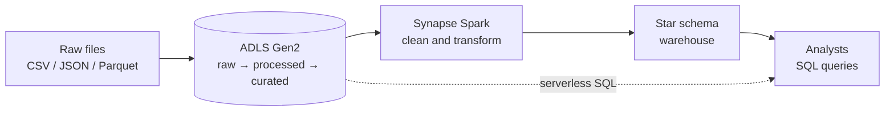

# SUMMARY : Requirements Gathering — Cloud Retail Data Lake & Data Warehouse

> **Status:** v1 · **Owner:** M1 (MAGED GAMAL AHMED) · **Last updated:** 2026-10-16

---

## At a Glance

| | |
|---|---|
| **Problem** | A retailer has scattered operational data and no scalable way to store raw data, process it, and give business users clean analytical tables. |
| **Solution** | A small Azure platform: **data lake → processing → warehouse**. |
| **Users get** | A star schema (Fact Sales + Product, Customer, Store, Date) they can query in seconds. |
| **Must-haves** | 13 functional requirements, 7 quality requirements |
| **Out of scope** | Real-time streaming, machine learning, full BI dashboards (see section 5) |

---

## 1. Stakeholders & Their Needs

> The retail business users are **simulated** (taken from the problem statement). The team and instructor are real.

| Stakeholder | What they care about | What we do about it |
|---|---|---|
| **Business analysts** (main users) | Trustworthy data, simple tables, fast queries | Star schema, data-quality checks, ≥ 8 documented sample queries |
| **Business managers** | Answers on sales by product, store, customer, time | Sample queries cover these four views |
| **Future readers** (GitHub visitors) | Understand and reuse the work quickly | Architecture diagram, short README, data dictionary |

---

## 2. Functional Requirements (what the system does)

Priority: **M** = Must · **C** = Could

| ID | Requirement | Pri. | Deliverable |
|---|---|---|---|
| FR1 | Upload raw CSV / JSON / Parquet to Azure Data Lake Storage Gen2 | M | ADLS folder structure |
| FR2 | Organise the lake into **raw / processed / curated** zones | M | ADLS folder structure |
| FR3 | Query lake files with Synapse **serverless SQL** | M | Synapse SQL scripts |
| FR4 | Clean and transform data with **PySpark** (types, nulls, duplicates) | M | PySpark notebooks |
| FR5 | Convert suitable datasets to **Parquet** | M | PySpark notebooks |
| FR6 | Build a **star schema**: Fact Sales, Dim Product, Dim Customer, Dim Store, Dim Date | M | Dimensional model |
| FR7 | Create Synapse external tables and views | M | Synapse SQL scripts |
| FR8 | Load curated data into the warehouse | M | Synapse SQL scripts |
| FR9 | Run basic **data-quality checks** (counts, nulls, duplicates, key integrity) | M | Data-quality validation |
| FR10 | Apply **access controls** (least privilege) | M | Security setup notes |
| FR11 | **Monitor** pipeline runs | M | Pipeline screenshots |
| FR12 | Provide sample analytical queries (≥ 8) | M | Sample queries |
| FR13 | Document the architecture (diagram, README) | M | Diagram, README |
| FR14 | *(Optional)* Delta Lake with partitioning / Z-ordering | C | Extension notebook |

---

## 3. Quality Requirements (how well it works)

Targets are starting points; they are tracked in `04-kpis.md`.

| Area | Requirement | Target | KPI |
|---|---|---|---|
| ⚡ **Performance** | Sample queries respond quickly | 95% of queries ≤ 10 s (serverless), ≤ 5 s (warehouse); full pipeline ≤ 30 min (baseline) | PERF-1, PERF-2, REL-4 |
| 🔁 **Reliability** | Pipeline runs succeed | ≥ 95% of runs | REL-1 |
| ✅ **Data quality** | Data can be trusted | 100% of critical checks pass; 0 orphan fact rows | DQ-1, DQ-3 |
| 🔒 **Security** | Only the right people and services have access; no secrets exposed | Least-privilege roles on every container and pool; 0 secrets in Git | SEC-1, SEC-2 |
| 🙂 **Usability** | Easy to understand and reproduce | A reviewer can follow the README and reproduce results; every deliverable documented; clear table and column names | USE-2, USE-3 |
| 💰 **Cost** | Stays within student credits | Spend ≤ budget; compute paused when idle | COST-1 |
| 📈 **Scalability / portability** | Design can grow without a rewrite | Parquet, date-based partitioning, logic kept portable (PySpark + SQL) | — |

---

## 4. Constraints & Assumptions

- **Time and people:** 8 weeks, 6 members, about 7 h/week each.
- **Platform:** Azure Synapse as in the proposal; create the Spark pool on **runtime 3.5**, since 3.4 is out of support.
- **Data:** public or synthetic retail data.
- **Budget:** limited Azure credits, so small pool sizes and auto-pause.

---

## 5. Out of Scope (proposed)

Real-time streaming · machine-learning models · a full BI dashboard (a small one can be added if time allows).

---

## 6. Definition of Success

The project is accepted when:
1. All **FR1–FR13** are demonstrated.
2. All **quality targets** are green on the final KPI scorecard.
3. A teammate can **reproduce** the results from the README.

---

