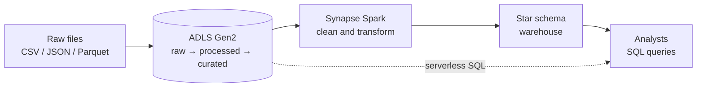
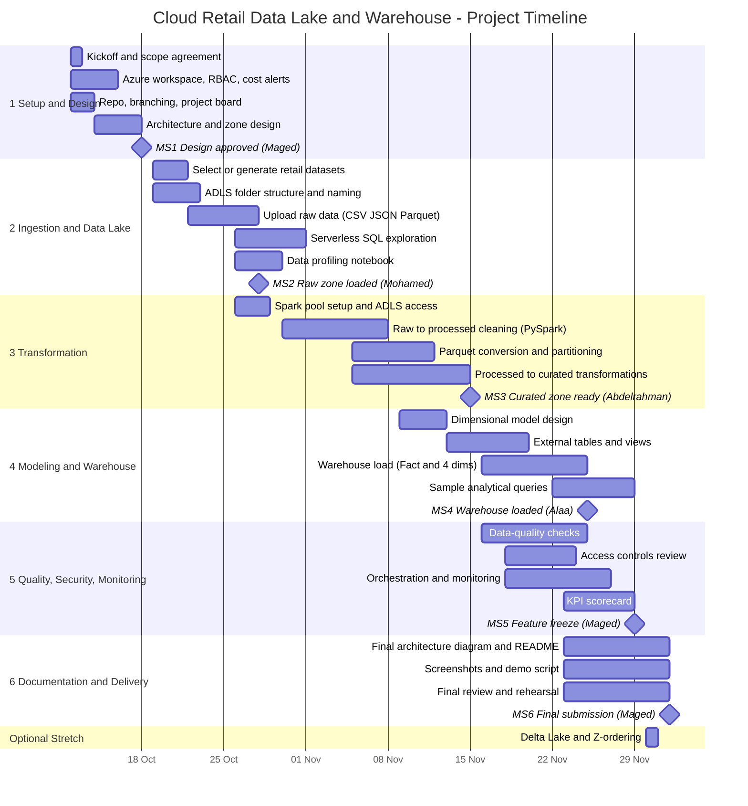

# Cloud Retail Data Lake & Data Warehouse

> **Version:** v1 · **Owner:** Maged Gamal Ahmed (Project Lead) · **Last updated:** 2026-10-19
> **Timeline:** 12 Oct – 2 Dec 2026 · **Team:** 6 members (see [5.1 Team Roster](#51-team-roster))

## Contents

1. [Project Overview](#1-project-overview)
2. [Requirements Gathering](#2-requirements-gathering)
3. [Literature Review](#3-literature-review)
4. [Project Plan](#4-project-plan)
5. [Team, Roles and Tasks](#5-team-roles-and-tasks)
6. [Risk Management](#6-risk-management)
7. [KPIs](#7-kpis)

---

## 1. Project Overview

### 1.1 Problem Statement

A retail organization has multiple operational datasets but needs a scalable cloud architecture for storing raw data, processing it, and providing structured analytical data to business users.

### 1.2 Project Objective

Build a small-scale Azure data platform using a **data lake → processing → warehouse** architecture. Raw files land in Azure Data Lake Storage Gen2 (ADLS), are cleaned and transformed with Synapse Spark (PySpark), and are served to business users through a dimensional model (Fact Sales + Dim Product, Dim Customer, Dim Store, Dim Date).

Azure's architecture guidance describes Data Lake Storage and Synapse as components that can work together for storing, processing, and querying data at scale. *(Microsoft Learn)*

### 1.3 Key Features / Scope

- Upload raw CSV / JSON / Parquet data to Azure Data Lake Storage Gen2
- Organize data into `raw` / `processed` / `curated` zones
- Query lake files using Synapse serverless SQL
- Transform data using Synapse Spark / PySpark
- Convert appropriate datasets to Parquet
- Create a dimensional model: Fact Sales, Dim Product, Dim Customer, Dim Store, Dim Date
- Create Synapse external tables / views
- Load curated data into a warehouse
- Implement basic data-quality checks
- Apply appropriate access controls
- Document the architecture
- Monitor pipeline execution

### 1.4 Expected Deliverables

1. Azure architecture diagram
2. ADLS folder structure
3. PySpark notebooks
4. Synapse SQL scripts
5. Dimensional model
6. Data-quality validation
7. Sample analytical queries
8. Pipeline screenshots
9. Technical README

### 1.5 Optional Extension

Add **Delta Lake** for transactional / ACID processing and optimize selected datasets using partitioning / Z-ordering. This stretch goal starts only after feature freeze (MS5).

---

## 2. Requirements Gathering

### 2.1 At a Glance

| | |
|---|---|
| **Problem** | A retailer has scattered operational data and no scalable way to store raw data, process it, and give business users clean analytical tables. |
| **Solution** | A small Azure platform: **data lake → processing → warehouse**. |
| **Users get** | A star schema (Fact Sales + Product, Customer, Store, Date) they can query in seconds. |
| **Must-haves** | 13 functional requirements, 7 quality requirements |
| **Out of scope** | Real-time streaming, machine learning, full BI dashboards (see [2.5](#25-out-of-scope-proposed)) |



### 2.2 Stakeholders and Their Needs

> The retail business users are **simulated** (taken from the problem statement).

| Stakeholder | What they care about | What we do about it |
|---|---|---|
| **Business analysts** (main users) | Trustworthy data, simple tables, fast queries | Star schema, data-quality checks, ≥ 8 documented sample queries |
| **Business managers** | Answers on sales by product, store, customer, time | Sample queries cover these four views |
| **Future readers** (GitHub visitors) | Understand and reuse the work quickly | Architecture diagram, short README, data dictionary |

### 2.3 Functional Requirements (what the system does)

Priority: **M** = Must · **C** = Could

| ID | Requirement | Pri. | Deliverable |
|---|---|---|---|
| FR1 | Upload raw CSV / JSON / Parquet to Azure Data Lake Storage Gen2 | M | ADLS folder structure |
| FR2 | Organize the lake into **raw / processed / curated** zones | M | ADLS folder structure |
| FR3 | Query lake files with Synapse **serverless SQL** | M | Synapse SQL scripts |
| FR4 | Clean and transform data with **PySpark** (types, nulls, duplicates) | M | PySpark notebooks |
| FR5 | Convert suitable datasets to **Parquet** | M | PySpark notebooks |
| FR6 | Build a **star schema**: Fact Sales, Dim Product, Dim Customer, Dim Store, Dim Date | M | Dimensional model |
| FR7 | Create Synapse external tables and views | M | Synapse SQL scripts |
| FR8 | Load curated data into the warehouse | M | Synapse SQL scripts |
| FR9 | Run basic **data-quality checks** (counts, nulls, duplicates, key integrity) | M | Data-quality validation |
| FR10 | Apply **access controls** (least privilege) | M | Security setup notes |
| FR11 | **Monitor** pipeline runs | M | Pipeline screenshots |
| FR12 | Provide sample analytical queries (≥ 8) | M | Sample queries |
| FR13 | Document the architecture (diagram, README) | M | Diagram, README |
| FR14 | *(Optional)* Delta Lake with partitioning / Z-ordering | C | Extension notebook |

### 2.4 Quality Requirements (how well it works)

Targets are starting points; they are tracked in [section 7](#7-kpis).

| Area | Requirement | Target | KPI |
|---|---|---|---|
| ⚡ **Performance** | Sample queries respond quickly | 95% of queries ≤ 10 s (serverless), ≤ 5 s (warehouse); full pipeline ≤ 30 min (baseline) | PERF-1, PERF-2, REL-4 |
| 🔁 **Reliability** | Pipeline runs succeed | ≥ 95% of runs | REL-1 |
| ✅ **Data quality** | Data can be trusted | 100% of critical checks pass; 0 orphan fact rows | DQ-1, DQ-3 |
| 🔒 **Security** | Only the right people and services have access; no secrets exposed | Least-privilege roles on every container and pool; 0 secrets in Git | SEC-1, SEC-2 |
| 🙂 **Usability** | Easy to understand and reproduce | A reviewer can follow the README and reproduce results; every deliverable documented; clear table and column names | USE-2, USE-3 |
| 💰 **Cost** | Stays within student credits | Spend ≤ budget; compute paused when idle | COST-1 |
| 📈 **Scalability / portability** | Design can grow without a rewrite | Parquet, date-based partitioning, logic kept portable (PySpark + SQL) | — |

### 2.5 Out of Scope (proposed)

Real-time streaming · machine-learning models · a full BI dashboard (a small one can be added if time allows).

### 2.6 Constraints and Assumptions

- **Time and people:** about 7.5 weeks (12 Oct – 2 Dec), 6 members, about 7 h/week each.
- **Platform:** Azure Synapse as in the proposal; create the Spark pool on **runtime 3.5**, since 3.4 is out of support.
- **Data:** public or synthetic retail data.
- **Budget:** limited Azure credits, so small pool sizes and auto-pause.

### 2.7 Definition of Success

The project is accepted when:

1. All **FR1–FR13** are demonstrated.
2. All **quality targets** are green on the final KPI scorecard.
3. A teammate can **reproduce** the results from the README.

---

## 3. Literature Review

> **Sources accessed:** 2026-10-16 · Citation keys in square brackets, e.g. **[M1]**, point to the reference list in [3.8](#38-references).

### 3.1 Purpose, Scope and Method

**Purpose.** Place our project (an Azure data lake → processing → warehouse platform for retail data) in the context of existing solutions, learn from their strengths and weaknesses, and show how our design differs.

**Our project in one paragraph.** Raw CSV / JSON / Parquet retail files are stored in Azure Data Lake Storage Gen2 (ADLS) organized into raw / processed / curated zones, explored with Synapse serverless SQL, transformed with Synapse Spark (PySpark), modeled as a star schema (Fact Sales + Dim Product, Customer, Store, Date), and loaded into a warehouse, with data-quality checks, access control, and pipeline monitoring. Delta Lake with partitioning / Z-ordering is an optional extension.

**How sources were found**

| Step | What was done |
|---|---|
| Search venues | Microsoft Learn (Architecture Center, Cloud Adoption Framework, Synapse and Fabric docs), GitHub, VLDB / CIDR proceedings, arXiv and Springer, publisher pages |
| Example queries | "Azure Synapse end-to-end analytics architecture", "data lake zones and containers", "Delta Lake VLDB 2020", "Lakehouse CIDR 2021", "Azure data engineering project retail ADLS Synapse star schema github", "Synapse runtime Spark 3.5 Delta", "Fabric vs Synapse" |
| Inclusion criteria | Relevant to Azure lakes / Synapse / dimensional modeling / lakehouse design; publicly accessible; identifiable author or organization; sufficiently documented to assess |
| Exclusion | Paywalled content we could not read, undated or anonymous posts, tutorials with no architecture detail |

**Source tiers** (used to weigh evidence)

| Tier | Meaning | Examples |
|---|---|---|
| **1** | Official vendor documentation, peer-reviewed papers, standard textbooks | [M1]–[M9], [A1]–[A3], [B1] |
| **2** | Open-source project repositories (self-reported, not peer-reviewed) | [P1]–[P3] |
| **3** | Analyst or consultancy commentary | [C1], [C2] |

### 3.2 Background Concepts

**Data lakes and zones.** A data lake stores large volumes of data in any format; its main risks are weak architecture and weak metadata, which can turn it into an unusable "data swamp" [A3]. Microsoft's cloud-scale analytics guidance recommends organizing the lake into layers: a raw layer that is kept immutable, an enriched (standardized) layer, and a curated layer that may hold star schemas or data marts. It also notes that a small deployment can consolidate the layers into one storage account [M3].

**Medallion naming.** The same idea is commonly named bronze (raw), silver (validated / enriched), and gold (curated). Microsoft's Fabric documentation describes it this way and recommends Delta tables for silver and gold [M8]. We map our zones as **raw = bronze, processed = silver, curated = gold**.

**Lakehouse and Delta Lake.** The lakehouse argument is that open formats such as Parquet on low-cost storage can support warehouse-style workloads and avoid the staleness, cost, and lock-in of two-tier lake-plus-warehouse systems [A2]. Delta Lake adds ACID transactions, time travel, and faster metadata operations to files in cloud object storage through a transaction log stored as Parquet [A1]. This is the basis of our optional extension.

**Dimensional modeling.** Kimball and Ross's star-schema approach structures analytical data as fact tables surrounded by descriptive dimensions, with retail sales as one of its standard case studies [B1]. It is the model behind our Fact Sales and four dimensions.

**Azure Synapse.** Microsoft's reference architecture uses ADLS as the home of data across all stages, Synapse pipelines to land data in the raw layer, serverless SQL and Spark pools for processing, and a SQL pool or the lake for serving [M1].

### 3.3 Similar Solutions Reviewed

#### 3.3.1 Microsoft reference architectures — [M1], [M2], [M4]

**What they are.** Official Azure Architecture Center scenarios, plus a deployment accelerator on GitHub.

- **[M1] Analytics end-to-end with Azure Synapse** shows ingest → store → process → serve → visualize. ADLS is the central store, pipelines copy relational and semi-structured sources into a raw layer, and both serverless SQL and Spark pools are available for processing. It gives guidance on lake layers, folder structure, and file formats.
- **[M2] Data warehouse scenario** (Architecture Center) takes a different shape: source exports land in a staging area in ADLS, Data Factory loads them incrementally into Synapse staging tables, then transforms them into a common structure. The lake is used mainly as a staging area, and the pipeline authenticates to Synapse with a service principal or managed identity.
- **[M4] Azure Synapse end-to-end accelerator** deploys a reference set of resources: a Synapse workspace, a small three-node Spark pool, a DW100 dedicated SQL pool, a Data Explorer pool, a standard LRS storage account, and a Purview account. Several of these are flagged as cost-incurring.

| Strengths | Weaknesses / limitations |
|---|---|
| Authoritative, maintained, and consistent with Microsoft's best practices | Generic enterprise scenarios, not a worked retail dimensional model |
| [M1] covers the whole lifecycle and both SQL engines | [M2] treats the lake as staging rather than as an analytical layer |
| [M4] shows realistic sizing and which resources cost money | [M4] provisions more services (Data Explorer, Purview) than a small student project needs, so cost control matters |
| Managed-identity authentication is shown ([M2]) | Pages describe architecture, not measurable success criteria |

**Relevance.** We follow the [M1] flow and the zone guidance in [M3], but we build the retail model and the quality / KPI layer that the reference material leaves open. We reviewed [M4] from its README only.

#### 3.3.2 Sales Analytics Dashboard – Azure — [P1]

**What it is.** A public GitHub project using Synapse, ADLS Gen2, Azure Data Factory, T-SQL / PySpark, and Power BI. It follows the bronze → silver → gold pattern. The gold layer is described as a **snowflake schema with one fact table and six dimension tables**, created with Synapse SQL scripts. Entities are e-commerce style (orders, sellers, reviews, geolocation).

| Strengths | Weaknesses / limitations |
|---|---|
| Clear medallion layering with a plain description of each layer | Snowflake design with six dimensions means more joins for analysts |
| Complete path from lake to a Power BI dashboard | The README does not list a **date dimension** |
| Repository includes data, source code, a report file, and the dashboard file | The README does not describe data-quality checks, access control, monitoring, or measurable results |
| Uses Synapse SQL scripts for modeling, similar to our approach | No description or topics on the repository, and no sign of external use or review |

**Relevance.** Confirms that our stack is a common pattern. It also shows two things to avoid: a missing date dimension and undocumented quality and security.

#### 3.3.3 DataFusion — [P2]

**What it is.** An end-to-end pipeline using the AdventureWorksLT sample database on a local SQL Server, Azure Data Factory (with a self-hosted integration runtime), ADLS Gen2, **Azure Databricks** for Spark transformations, **Delta** tables in the silver and gold layers, Synapse **serverless SQL** over gold with views and stored procedures, and Power BI with DirectQuery.

| Strengths | Weaknesses / limitations |
|---|---|
| Most complete treatment of **security and governance**: Azure AD role-based access, least privilege, Key Vault for secrets, encryption | Depends on several separately billed services (Databricks, Data Factory, Synapse, Power BI), which raises cost and complexity for a small team |
| Uses Delta for silver and gold, giving versioning and ACID behavior | Source is a small sample database, yet the README describes handling "large datasets" without evidence |
| Includes validation rules in transformations and Azure Monitor for pipeline tracking | Quality, performance, and testing claims are stated without numbers (no row counts, runtimes, or test results) |
| Serverless SQL over the lake keeps the serving layer lightweight | The README says data is in "fact and dimension tables" but does not specify the model |

**Relevance.** The closest match to our lake-first approach, and the best model for the security section of our README. We replace Databricks and Data Factory with Synapse Spark and Synapse pipelines to keep everything in one workspace, and we add measurable evidence (KPIs).

#### 3.3.4 SuperStore Sales Data Engineering — [P3]

**What it is.** A pipeline that extracts sales data from PostgreSQL, cleans it and builds a **star schema** in Python, uploads the result to **Azure Blob Storage**, loads it into a **Synapse dedicated SQL pool**, and builds Power BI dashboards. Apache Airflow, run in a local WSL environment, orchestrates the process. The dataset has 9,993 transactions from 2019 to 2022.

| Strengths | Weaknesses / limitations |
|---|---|
| Simple, easy to follow, with an ERD and screenshots of the pipeline run and role assignment | Blob Storage is used only as a hand-off, with **no lake zones and no Spark processing** |
| Star schema with a dedicated warehouse | Small, already-clean dataset (the README says no missing values), so little data-quality work is shown |
| Orchestration is automated and visible | Orchestration runs from a local environment rather than a managed cloud service |
| Clear technology list | No monitoring, quality checks, or measurable targets described |

**Relevance.** Shows a minimal warehouse-first pipeline. It highlights what a zoned lake and Spark processing add (handling raw, multi-format, messy data), which is the core of our proposal.

#### 3.3.5 The lakehouse and Fabric direction — [A1], [A2], [M8], [M9], [M5], [C1], [C2]

**What it is.** Not a competing project but the direction in which platforms are moving. Lakehouse research argues for open formats and a single platform for analytics [A2], Delta Lake supplies the transactional layer [A1], and Microsoft documents a medallion pattern in Fabric in which silver and gold use Delta tables [M8]. One documented option there keeps bronze and silver in lakehouses and makes gold a **data warehouse**, which is the same shape as our design [M8].

**Platform status relevant to us**

- Microsoft documents migration paths from Synapse dedicated SQL pools and Synapse Spark to Fabric [M9].
- The Synapse Spark 3.5 runtime (Spark 3.5, Delta Lake 3.2) enters long-term support on 1 Nov 2027, running to 31 Oct 2028, and Microsoft encourages moving to Fabric Runtime 2.0 [M5].
- The Synapse Spark 3.4 runtime reached end of support on 31 Mar 2026 [M6], so new pools should use 3.5.
- Independent analysts reported in 2025 that Synapse remained supported for now but that customers should not expect to stay on it indefinitely [C1], and that moving workloads to Fabric requires manual changes to notebooks, SQL scripts, and pipelines [C2].

| Strengths | Weaknesses / limitations |
|---|---|
| Open formats and ACID tables reduce lock-in and staleness [A1][A2] | The lakehouse papers come from the Databricks authors and argue a position |
| Fabric simplifies the number of services to manage [C2] | Synapse (the platform in our proposal) is on a longer-term path toward Fabric [M5][C1] |
| Official migration guidance exists [M9] | Migration is not automatic for everything [C2] |

**Relevance.** Our proposal specifies Synapse, so we stay on it. We keep the logic portable (PySpark, SQL, Parquet / Delta) and note Fabric as future work.

### 3.4 Comparison With Our Project

"Not documented" means the project's README did not describe it, not that it is absent. "Not assessed" means we did not review that aspect of the source.

| Criterion | **Our project** | Microsoft reference [M1][M4] | Sales Analytics Dashboard [P1] | DataFusion [P2] | SuperStore [P3] |
|---|---|---|---|---|---|
| Source data | Files: CSV / JSON / Parquet | Relational and semi-structured via pipelines | Multiple sources (unspecified) | SQL Server sample DB | PostgreSQL (CSV-derived) |
| Lake storage | ADLS Gen2 | ADLS Gen2 | ADLS Gen2 | ADLS Gen2 | Blob Storage (hand-off only) |
| Zones | raw / processed / curated | Layered raw zone and others | Bronze / silver / gold | Bronze / silver / gold | None |
| Processing | Synapse Spark (PySpark) | Spark pools and pipelines | T-SQL / PySpark in Synapse | Databricks (Spark) | Python ETL + Airflow |
| Serverless SQL on lake | **Yes** | Yes | Not documented | **Yes** | No |
| Warehouse / serving | Synapse warehouse, star schema | SQL pool or lake | Gold layer via Synapse SQL | Serverless over Delta gold | Dedicated SQL pool |
| Model | Star: Fact Sales + 4 dims **incl. Dim Date** | Not applicable | Snowflake: 1 fact + 6 dims, no date dim listed | Fact and dims (unspecified) | Star (ERD shown) |
| File format | Parquet (+ optional Delta) | Guidance on formats | Not documented | Delta (silver / gold) | Not documented |
| Orchestration | Synapse pipelines | Synapse pipelines | Data Factory | Data Factory | Airflow (local WSL) |
| Data quality | Automated checks, tracked as KPIs | Guidance only | "Cleaned, validated" silver layer | Validation rules in notebooks | Cleaning and dedup in ETL |
| Security | RBAC / ACLs, least privilege, no secrets in Git | Not assessed | Not documented | **RBAC, Key Vault, encryption** | Role assignment shown |
| Monitoring | Synapse Monitor + KPI scorecard | Not assessed | Not documented | Azure Monitor | DAG run screenshots |
| BI layer | Sample SQL queries | Power BI | Power BI | Power BI | Power BI |
| Measurable targets (KPIs) | **Yes** | Not applicable | Not documented | Not documented | Not documented |
| Project management artifacts (plan, RACI, risks) | **Yes** | Not applicable | Not documented | Not documented | Not documented |

### 3.5 Synthesis

**What works across the projects**

- Layered storage (bronze / silver / gold) and a star-like model are the common, accepted pattern [M3][M8][P1][P2].
- Keeping everything inside one Azure ecosystem simplifies access control and monitoring [M1][P2].
- Open formats (Parquet / Delta) are the dominant storage choice for processed data [A1][A2][M8][P2].

**Recurring weaknesses**

1. **Quality, security, and monitoring are thin or undocumented**, apart from [P2].
2. **Cost and complexity** grow when many paid services are stacked [P2][M4].
3. **Modeling gaps**: a missing date dimension and an over-normalized snowflake in [P1]; an unspecified model in [P2].
4. **Weak lake usage**: [P3] and [M2] treat storage as a pass-through rather than an analytical layer.
5. **Platform drift**: Spark runtimes and the Synapse-to-Fabric direction change quickly, and some third-party material is already out of date [M5][M6].

### 3.6 How Our Project Differs

1. **Lake-first, multi-format ingestion.** We start from CSV / JSON / Parquet files, not a single relational database as in [P2] and [P3].
2. **Explicit zone design** with an immutable raw zone, following Microsoft's guidance [M3].
3. **Both lake and warehouse access.** Serverless SQL over the lake *and* a warehouse serving layer; [P2] has only the former and [P3] only the latter.
4. **A complete star schema with a date dimension**, designed from a written grain statement, rather than the snowflake in [P1] [B1].
5. **Measured quality.** Automated data-quality checks and a KPI scorecard (see [section 7](#7-kpis)), where the reviewed projects give only statements.
6. **Engineering discipline.** Documented plan, RACI, risk register, and cost controls (see [sections 4–6](#4-project-plan)).
7. **Optional Delta Lake / Z-ordering extension.** Not unique ([P2] uses Delta), but included as a stretch goal [A1].

**Honest limits of the difference.** The architecture is conventional, so our contribution is mostly in rigor, evidence, and documentation, not novelty. We also deliberately leave out a Power BI dashboard, which all three projects include. The team can add a small dashboard if time allows.

### 3.7 Insights That Will Be Applied to Our Design

| # | Insight | Source | Decision for our project |
|---|---|---|---|
| 1 | Synapse Spark 3.4 is out of support; 3.5 is current (Delta Lake 3.2) | [M5][M6][M7] | Create the Spark pool on **runtime 3.5**; confirm in our pool that OPTIMIZE / Z-ORDER commands run before promising them |
| 2 | Raw data should be immutable; layers can share one account at small scale | [M3] | Keep `raw/` write-once; one storage account with a container per zone |
| 3 | The curated layer may hold star schemas | [M3] | `curated/` stores model-ready Parquet for Fact Sales and the four dimensions |
| 4 | Bronze / silver / gold is the common naming | [M8] | Document the mapping to raw / processed / curated in the README |
| 5 | A documented pattern keeps lake layers and makes gold a warehouse | [M8] | Cite this as the justification for our lake + warehouse design |
| 6 | Open formats; Delta adds ACID and time travel | [A1][A2] | Parquet by default; Delta only in the stretch task (T26) |
| 7 | Weak metadata turns lakes into swamps | [A3] | Data dictionary (T06), naming conventions (T07), and a README section per dataset; Purview is optional because it adds cost [M4] |
| 8 | Dimensional modeling guidance and the retail example | [B1] | Write the grain statement first; include **Dim Date**; keep a star, not a snowflake |
| 9 | Least privilege, managed identity, Key Vault | [P2][M2] | RBAC / ACLs (T20); no secrets in Git (R08) |
| 10 | Compute services cost money | [M4] | Auto-pause Spark; pause the warehouse when idle (R01) |
| 11 | Pipelines can run inside the Synapse workspace | [M1] | Use Synapse pipelines instead of an external orchestrator ([P3]) or a separate Data Factory ([P1][P2]) |
| 12 | Synapse → Fabric is the platform trajectory | [M5][M9][C1] | Keep logic portable (PySpark, SQL, Parquet / Delta); list Fabric migration under future work |
| 13 | Reviewed projects make claims without numbers | [P2] | Record evidence in the KPI scorecard (row counts, runtimes, pass rates, spend) |

### 3.8 References

*Format: numbered, IEEE-style. All URLs accessed 2026-10-16. Microsoft Learn URLs are shown without a language code, so they open in your own locale.*

#### Official documentation (Tier 1)

- **[M1]** Microsoft, "Analytics end-to-end with Azure Synapse," *Azure Architecture Center*, Microsoft Learn. https://learn.microsoft.com/azure/architecture/example-scenario/dataplate2e/data-platform-end-to-end
- **[M2]** Microsoft, Azure Architecture Center example scenario "data warehouse" (page path `/example-scenario/data/data-warehouse`), Microsoft Learn. https://learn.microsoft.com/en-us/azure/architecture/example-scenario/data/data-warehouse
- **[M3]** Microsoft, "Data lake zones and containers," *Cloud Adoption Framework: cloud-scale analytics best practices*, Microsoft Learn. https://learn.microsoft.com/azure/cloud-adoption-framework/scenarios/cloud-scale-analytics/best-practices/data-lake-zones
- **[M4]** Microsoft Azure, "Azure Analytics End to End with Azure Synapse – Deployment Accelerator," GitHub repository. https://github.com/Azure/azure-synapse-analytics-end2end
- **[M5]** Microsoft, "Azure Synapse Runtime for Apache Spark 3.5," Microsoft Learn. https://learn.microsoft.com/azure/synapse-analytics/spark/apache-spark-35-runtime
- **[M6]** Microsoft, "Azure Synapse Runtime for Apache Spark 3.4," Microsoft Learn (end-of-support notice). https://learn.microsoft.com/azure/synapse-analytics/spark/apache-spark-34-runtime
- **[M7]** Microsoft, "Synapse runtime for Apache Spark lifecycle and supportability," Microsoft Learn. https://learn.microsoft.com/azure/synapse-analytics/spark/runtime-for-apache-spark-lifecycle-and-supportability
- **[M8]** Microsoft, "Understand medallion lakehouse architecture for Microsoft Fabric with OneLake," Microsoft Learn. https://learn.microsoft.com/fabric/onelake/onelake-medallion-lakehouse-architecture
- **[M9]** Microsoft, Microsoft Fabric migration overview ("Migrate from legacy, on-premises, or PaaS platforms"), Microsoft Learn. https://learn.microsoft.com/fabric/fundamentals/migration

#### Peer-reviewed papers and books (Tier 1)

- **[A1]** M. Armbrust *et al.*, "Delta Lake: High-Performance ACID Table Storage over Cloud Object Stores," *Proc. VLDB Endowment*, vol. 13, no. 12, pp. 3411–3424, 2020. https://vldb.org/pvldb/vol13/p3411-armbrust.pdf
- **[A2]** M. Armbrust, A. Ghodsi, R. Xin, and M. Zaharia, "Lakehouse: A New Generation of Open Platforms that Unify Data Warehousing and Advanced Analytics," in *Proc. 11th Conf. on Innovative Data Systems Research (CIDR '21)*, Jan. 11–15, 2021. https://www.cidrdb.org/cidr2021/papers/cidr2021_paper17.pdf
- **[A3]** P. Sawadogo and J. Darmont, "On data lake architectures and metadata management," *Journal of Intelligent Information Systems*, vol. 56, no. 1, pp. 97–120, 2021. DOI: https://doi.org/10.1007/s10844-020-00608-7 (preprint: https://arxiv.org/abs/2107.11152)
- **[B1]** R. Kimball and M. Ross, *The Data Warehouse Toolkit: The Definitive Guide to Dimensional Modeling*, 3rd ed. Indianapolis, IN, USA: John Wiley & Sons, 2013. ISBN 978-1-118-53080-1.

#### Open-source project repositories (Tier 2)

- **[P1]** Dayyak, "Sales-Analytics-Dashboard-Azure," GitHub repository. https://github.com/Dayyak/Sales-Analytics-Dashboard-Azure *(a search result listed this repository as "Ecom-Data-Platform"; GitHub redirects to the current name)*
- **[P2]** mehtavandit, "DataFusion," GitHub repository. https://github.com/mehtavandit/DataFusion
- **[P3]** ShawonSimon, "SuperStore-Sales-Data-Engineering," GitHub repository. https://github.com/ShawonSimon/SuperStore-Sales-Data-Engineering

#### Analyst and consultancy commentary (Tier 3)

- **[C1]** Directions on Microsoft, "Synapse Analytics Roadmap," Oct. 16, 2025. https://www.directionsonmicrosoft.com/roadmaps/ref/synapse-analytics-roadmap/ *(partly behind a membership wall; we read only the visible summary)*
- **[C2]** B. Smart, "Azure Synapse Analytics vs Microsoft Fabric: side-by-side comparison," *endjin*. https://endjin.com/blog/azure-synapse-analytics-versus-microsoft-fabric-a-side-by-side-comparison *(publication date not confirmed)*

---

## 4. Project Plan

### 4.1 Planning Assumptions

| Assumption | Value |
|---|---|
| Team size | 6 members |
| Effort per member | ~7 h/week |
| Duration | ~7.5 weeks (Mon 12 Oct → Wed 2 Dec 2026) |
| Total capacity | ~312 person-hours (6 × ~52 h) |
| Planned task effort | ~239 h (+16 h optional); the rest (~23%) is buffer for meetings, reviews, learning curve and rework |
| Azure student subscription | One shared subscription with limited credits |

### 4.2 Timeline (Gantt)

> Rendered natively by GitHub. In other viewers, paste the block into <https://mermaid.live>.



### 4.3 Phases

| # | Phase | Dates | Goal | Exit criteria |
|---|---|---|---|---|
| 1 | Setup & Design | 12 – 18 Oct | Everyone can work in Azure and Git; architecture agreed | Architecture v1 approved; all members can open the Synapse workspace and ADLS; repo and board live |
| 2 | Ingestion & Data Lake | 19 Oct – 1 Nov | Raw data in the lake and queryable | Datasets in `raw/`; serverless SQL queries return correct counts; profiling notes written |
| 3 | Transformation | 26 Oct – 15 Nov | Clean, typed, Parquet-based `processed` and `curated` zones | PySpark notebooks run end-to-end from a clean state |
| 4 | Modeling & Warehouse | 9 – 29 Nov | Star schema built and loaded; analysts can query it | Fact Sales + 4 dims loaded; external tables/views work; ≥ 8 sample queries run |
| 5 | Quality, Security, Monitoring | 16 – 29 Nov | Platform is trustworthy and observable | DQ checks automated; least-privilege access in place; pipeline runs monitored |
| 6 | Documentation & Delivery | 23 Nov – 2 Dec | Everything reproducible and presentable | README tested from a fresh clone; demo rehearsed |

### 4.4 Milestones

| ID | Date | Milestone | Acceptance criteria | Owner |
|---|---|---|---|---|
| MS1 | 18 Oct | Design approved | Architecture diagram v1, zone layout, source schema / data dictionary agreed; Azure access verified for all | Maged |
| MS2 | 28 Oct | Raw zone loaded | All source datasets in ADLS `raw/` (CSV, JSON, Parquet); upload steps documented | Mohamed |
| MS3 | 15 Nov | Curated zone ready | Cleaned Parquet datasets in `processed/` and `curated/`; notebooks reproducible | Abdelrahman |
| MS4 | 25 Nov | Warehouse loaded | Fact Sales and 4 dimensions loaded; external tables/views created; row counts reconcile | Alaa |
| MS5 | 29 Nov | Feature freeze | DQ checks, access control, monitoring and KPI scorecard in place; only docs and bug fixes afterwards | Maged |
| MS6 | 2 Dec | Final submission | All deliverables complete; demo rehearsed | Maged |

### 4.5 Deliverables

| # | Deliverable | Accountable | Due | Status |
|---|---|---|---|---|
| 1 | Azure architecture diagram | Mohamed | v1: MS1 · final: MS6 | ⬜ |
| 2 | ADLS folder structure | Mohamed | MS2 | ⬜ |
| 3 | PySpark notebooks | Abdelrahman | MS3 | ⬜ |
| 4 | Synapse SQL scripts | Alaa | MS4 | ⬜ |
| 5 | Dimensional model (ERD + grain + keys) | Alaa | Design: 13 Nov · final: MS4 | ⬜ |
| 6 | Data-quality validation | Esraa | MS5 | ⬜ |
| 7 | Sample analytical queries | Esraa | MS5 | ⬜ |
| 8 | Pipeline screenshots | Maged (collected from Asmaa) | MS6 | ⬜ |
| 9 | Technical README | Maged | MS6 | ⬜ |
| 10 | *(Optional)* Delta Lake extension | Abdelrahman | After MS5 | ⬜ |

Status key: ⬜ not started · 🟨 in progress · 🟩 done · 🟥 blocked

### 4.6 Resource Allocation

#### People

| Member | Role | Reports to | Owned task hours | Capacity (~7.5 wks) | Utilization |
|---|---|---|---|---|---|
| Maged | Project Lead & Documentation | — | 34 h | 52 h | 65% |
| Asmaa | Cloud Infrastructure, Security & Pipeline Ops | Maged | 35 h | 52 h | 67% |
| Mohamed | Ingestion & Data Lake Engineer | Maged | 42 h | 52 h | 81% |
| Abdelrahman | Transformation Engineer (PySpark) | Maged | 44 h | 52 h | 85% |
| Alaa | Warehouse & Dimensional Modeling Engineer | Maged | 42 h | 52 h | 81% |
| Esraa | Data Quality & Analytics Engineer | Maged | 42 h | 52 h | 81% |

> Abdelrahman's work (PySpark) is on the critical path: Mohamed and Maged should shadow him during phase 3 so progress doesn't depend on one person. The optional Delta Lake task (+16 h) goes to Abdelrahman only if the schedule is green after MS5. On top of his current load it would take him to about 115% of capacity, so share it with Maged or Asmaa, who have the most slack.

#### Involvement by phase

● lead · ○ support · – not involved

| Member | P1 Setup | P2 Lake | P3 Transform | P4 Warehouse | P5 Quality/Sec | P6 Docs |
|---|---|---|---|---|---|---|
| Maged | ● | ○ | ○ | ○ | ○ | ● |
| Asmaa | ● | ○ | ○ | ○ | ● | ○ |
| Mohamed | ● | ● | ● | ○ | – | ● |
| Abdelrahman | – | ○ | ● | ○ | ○ | – |
| Alaa | ○ | ○ | ○ | ● | ○ | ○ |
| Esraa | ○ | ● | ○ | ● | ● | ○ |

#### Azure resources

| Resource | Purpose | Sizing / cost control | Owner |
|---|---|---|---|
| Resource group + budget alerts | Single container for all resources | Alerts at 50 / 80 / 100% of credits | Asmaa |
| ADLS Gen2 storage account | Data lake (`raw`, `processed`, `curated`) | Hierarchical namespace on; LRS redundancy | Mohamed / Asmaa |
| Synapse workspace | Central workspace: SQL, Spark, pipelines, monitoring | One shared workspace | Asmaa |
| Serverless SQL pool | Query lake files, external tables/views | Pay per data scanned; query Parquet, avoid `SELECT *` on CSV | Alaa |
| Apache Spark pool | PySpark transformations | Smallest node size, minimum nodes, **auto-pause ≈ 15 min** | Abdelrahman / Asmaa |
| Warehouse (dedicated SQL pool or alternative) | Serving layer for the star schema | Lowest DWU; **pause when idle**; fallback in the risk register | Alaa |
| Azure Monitor / Synapse Monitor hub | Pipeline and query monitoring | Default retention | Asmaa |
| Key Vault *(optional)* | Secrets instead of keys in code | Only if needed | Asmaa |

#### Tools

GitHub (repo, pull requests, Projects board for tasks) · Synapse Studio notebooks / Jupyter · draw.io or Mermaid for diagrams · Faker or a public retail dataset for source data · a team chat channel for async updates.

### 4.7 Cadence and Communication

| Event | When | Length | Purpose |
|---|---|---|---|
| Weekly planning | Monday | 30 min | Review the board, confirm the week's tasks, check risks |
| Mid-week sync | Wednesday | 15 min | Blockers and hand-offs |
| Friday demo & retro | Friday | 30 min | Show what works; update KPI scorecard; what to change |
| Async stand-up | Mon / Wed / Fri in chat | 2 min | Done · doing · blocked |
| PR review SLA | Always | — | Reviewed within 24 h |

### 4.8 Scope and Change Control

1. Any new scope is raised as a GitHub issue labeled `scope-change`.
2. Maged plus at least two other members approve or reject within 48 h.
3. An approved change must name what it replaces or which milestone it moves.
4. The optional Delta Lake extension is **not** started until MS5 is green.

---

## 5. Team, Roles and Tasks

Tables in this document use first names.

### 5.1 Team Roster

| Name | GitHub handle | Role | Backup (buddy) |
|---|---|---|---|
| Maged Gamal Ahmed | @Migo9000 | Project Lead & Documentation | Abdelrahman |
| Asmaa Mohamed Omar | @asmaaomar2135-afk | Cloud Infrastructure, Security & Pipeline Ops | Esraa |
| Mohamed Elsaid Abdelrahman Moafi | @Mohamed-Moafi | Ingestion & Data Lake Engineer | Alaa |
| Abdelrahman Adel Mohamed | @Drrahman | Transformation Engineer (PySpark) | Maged |
| Alaa' Ahmed Kamal | _@handle (to add)_ | Warehouse & Dimensional Modeling Engineer | Mohamed |
| Esraa Mohamed Khalef | @e106sraamohameed-svg | Data Quality & Analytics Engineer | Asmaa |

Each person has a **backup** who understands their work well enough to continue it if they're unavailable. Backups review the owner's pull requests.

### 5.2 Role Descriptions

#### Maged — Project Lead & Documentation

- **Mission:** keep the project on schedule, scope, and documented.
- **Responsibilities:** run the meeting cadence, maintain the board / Gantt / risk register / KPI scorecard, approve scope changes, unblock teammates, own the final demo.
- **Owns:** Technical README, pipeline screenshots, KPI scorecard, documentation consolidation.

#### Asmaa — Cloud Infrastructure, Security & Pipeline Ops

- **Mission:** a secure, cost-controlled Azure environment that everyone can use.
- **Responsibilities:** provision resource group, ADLS, Synapse workspace and pools; RBAC / ACLs and least privilege; budget alerts and auto-pause; secrets handling; pipeline orchestration and monitoring.
- **Owns:** access-control setup, pipeline triggers and monitoring, role-assignment documentation.

#### Mohamed — Ingestion & Data Lake Engineer

- **Mission:** get data into the lake in an organized, repeatable way.
- **Responsibilities:** select or generate retail datasets and the data dictionary; ADLS folder structure and naming; raw uploads; Parquet conversion and partitioning strategy; architecture diagram.
- **Owns:** ADLS folder structure, architecture diagram (v1 and final), ingestion documentation.

#### Abdelrahman — Transformation Engineer (PySpark)

- **Mission:** turn raw files into clean, typed, analysis-ready datasets.
- **Responsibilities:** PySpark notebooks for raw → processed → curated; explicit schemas; handling nulls, duplicates, bad dates; conformed dimensions with surrogate keys; optional Delta Lake extension.
- **Owns:** PySpark notebooks.

#### Alaa — Warehouse & Dimensional Modeling Engineer

- **Mission:** a correct, documented star schema that answers business questions.
- **Responsibilities:** grain statement, ERD, keys; external tables and views; warehouse DDL and load scripts for Fact Sales, Dim Product, Dim Customer, Dim Store, Dim Date.
- **Owns:** dimensional model, Synapse SQL scripts.

#### Esraa — Data Quality & Analytics Engineer

- **Mission:** make sure the data can be trusted and the platform proves its value.
- **Responsibilities:** serverless SQL exploration; profiling; automated DQ checks (row counts, nulls, duplicates, referential integrity); sample analytical queries; supports KPI measurement.
- **Owns:** data-quality validation, sample analytical queries.

### 5.3 RACI Matrix

**R** = does the work · **A** = accountable / signs off · **C** = consulted · **I** = informed

| Activity | Maged | Asmaa | Mohamed | Abdelrahman | Alaa | Esraa |
|---|---|---|---|---|---|---|
| Architecture design & diagram | A | C | R | C | C | I |
| Azure provisioning, RBAC, cost control | A | R | C | C | I | I |
| Source data & ingestion to raw zone | A | C | R | I | C | C |
| Serverless SQL exploration | A | I | C | I | C | R |
| PySpark cleaning & curated transformations | A | C | C | R | C | C |
| Parquet conversion & partitioning | A | I | R | C | I | I |
| Dimensional model design | A | I | C | C | R | C |
| External tables, views, warehouse load | A | C | C | C | R | I |
| Data-quality checks | A | I | C | C | C | R |
| Access control | A | R | I | I | C | I |
| Orchestration & monitoring | A | R | I | C | C | C |
| Sample analytical queries | A | I | I | I | C | R |
| KPI tracking | A / R | C | I | I | I | C |
| README, screenshots, demo | A / R | C | C | C | C | C |

### 5.4 Task Backlog

Estimates are in hours. Task IDs are used as GitHub issue titles and branch names (e.g. `feature/T12-clean-sales`).

#### Phase 1 — Setup & Design (12 – 18 Oct)

| ID | Task | Owner | Support | Est. | Depends on | Status |
|---|---|---|---|---|---|---|
| T01 | Agree scope, roles, meeting cadence | Maged | All | 4 | — | ⬜ |
| T02 | Create resource group, ADLS Gen2 account, Synapse workspace | Asmaa | Mohamed | 6 | — | ⬜ |
| T03 | Configure RBAC for all members and budget alerts | Asmaa | Maged | 3 | T02 | ⬜ |
| T04 | Repo structure, branch protection, project board | Maged | Esraa | 4 | — | ⬜ |
| T05 | Architecture diagram v1 and zone layout | Mohamed | Asmaa, Alaa | 6 | T01 | ⬜ |

#### Phase 2 — Ingestion & Data Lake (19 Oct – 1 Nov)

| ID | Task | Owner | Support | Est. | Depends on | Status |
|---|---|---|---|---|---|---|
| T06 | Select / generate retail datasets (sales, products, customers, stores) in CSV / JSON / Parquet + data dictionary | Mohamed | Alaa | 10 | T05 | ⬜ |
| T07 | Create `raw` / `processed` / `curated` structure and naming conventions | Mohamed | Asmaa | 4 | T02 | ⬜ |
| T08 | Upload raw data and document the steps | Mohamed | Esraa | 8 | T06, T07 | ⬜ |
| T09 | Serverless SQL exploration scripts over raw files | Esraa | Mohamed | 8 | T08 | ⬜ |
| T10 | Data-profiling notebook (nulls, duplicates, types, ranges) | Esraa | Abdelrahman | 8 | T08 | ⬜ |

#### Phase 3 — Transformation (26 Oct – 15 Nov)

| ID | Task | Owner | Support | Est. | Depends on | Status |
|---|---|---|---|---|---|---|
| T11 | Spark pool setup and ADLS connectivity | Asmaa | Abdelrahman | 4 | T02, T03 | ⬜ |
| T12 | PySpark raw → processed cleaning notebooks | Abdelrahman | Esraa | 24 | T10, T11 | ⬜ |
| T13 | Convert datasets to Parquet; define partitioning strategy | Mohamed | Abdelrahman | 10 | T12 | ⬜ |
| T14 | Processed → curated transformations (conformed dimensions, surrogate keys) | Abdelrahman | Alaa | 20 | T12 | ⬜ |

#### Phase 4 — Modeling & Warehouse (9 – 29 Nov)

| ID | Task | Owner | Support | Est. | Depends on | Status |
|---|---|---|---|---|---|---|
| T15 | Dimensional model design (grain, ERD, keys) | Alaa | Abdelrahman | 10 | T10 | ⬜ |
| T16 | Create Synapse external tables and views | Alaa | Mohamed | 12 | T13, T15 | ⬜ |
| T17 | Warehouse DDL and load scripts for Fact Sales + 4 dimensions | Alaa | Abdelrahman | 20 | T14, T15 | ⬜ |
| T18 | Sample analytical queries (≥ 8) | Esraa | Alaa | 10 | T17 | ⬜ |

#### Phase 5 — Quality, Security, Monitoring (16 – 29 Nov)

| ID | Task | Owner | Support | Est. | Depends on | Status |
|---|---|---|---|---|---|---|
| T19 | Data-quality checks (row counts, nulls, uniqueness, referential integrity) | Esraa | Abdelrahman, Alaa | 16 | T14, T17 | ⬜ |
| T20 | Access controls: RBAC / ACLs, least privilege, secrets handling | Asmaa | Maged | 8 | T03 | ⬜ |
| T21 | Pipeline orchestration (triggers) and monitoring | Asmaa | Esraa | 14 | T14, T17 | ⬜ |
| T22 | KPI scorecard and weekly measurement routine | Maged | Esraa | 6 | T21 | ⬜ |

#### Phase 6 — Documentation & Delivery (23 Nov – 2 Dec)

| ID | Task | Owner | Support | Est. | Depends on | Status |
|---|---|---|---|---|---|---|
| T23 | Final architecture diagram | Mohamed | Asmaa | 4 | T21 | ⬜ |
| T24 | Technical README and docs consolidation | Maged | All | 12 | T19 – T21 | ⬜ |
| T25 | Pipeline screenshots, demo script, rehearsal | Maged | All | 8 | T21 | ⬜ |

#### Optional stretch

| ID | Task | Owner | Support | Est. | Depends on | Status |
|---|---|---|---|---|---|---|
| T26 | Delta Lake conversion; partitioning / Z-ordering on selected datasets | Abdelrahman | Alaa | 16 | MS5 green | ⬜ |

**Total planned effort:** ~239 h (+16 h optional).

### 5.5 Working Agreements

#### Git workflow

- `main` is protected: changes only through pull requests, **at least 1 approval** (the owner's backup where possible).
- Branch names: `feature/<task-id>-<short-name>`, e.g. `feature/T17-load-fact-sales`.
- Small PRs (one task or less), reviewed within 24 h.
- **Never commit secrets** (account keys, SAS tokens, connection strings). Use environment variables or Key Vault; keep a `.gitignore` for credentials and local data.

#### Notebooks

- Name: `NN_<zone>_<dataset>.ipynb`, e.g. `02_processed_sales.ipynb`.
- Clear outputs before committing (or use `nbstripout`) to keep diffs readable.
- One owner per notebook; others propose changes through PRs.
- Every notebook states its inputs, outputs, and run order in the first cell.

#### Suggested repo layout

```
.
├── README.md
├── docs/                 # project document + architecture diagram
├── notebooks/            # PySpark / profiling notebooks
├── sql/                  # serverless SQL, external tables, warehouse DDL, sample queries
├── data_quality/         # DQ checks and results
├── sample_data/          # small samples only (large data stays in ADLS)
└── screenshots/
```

#### Definition of Done (every task)

- [ ] Code / SQL committed through a reviewed PR
- [ ] Runs from a clean state without manual fixes
- [ ] Inputs, outputs and assumptions documented (README section or notebook header)
- [ ] No secrets or large data files in Git
- [ ] Board updated and, if relevant, a screenshot saved

#### Escalation

1. Blocked > 24 h: post in the team channel and tag the buddy and Maged.
2. Unresolved after 48 h: Maged reassigns or adjusts scope, and logs it in the risk register.
3. Disagreement on design: timebox 20 min in the next sync, then Maged decides and records it in `docs/decisions.md`.

---

## 6. Risk Management

> Review weekly in the Monday planning meeting. Update scores, status, and add new risks as they appear.

### 6.1 Method

**Score = Likelihood × Impact**, each rated 1 – 5.

| Rating | Likelihood | Impact |
|---|---|---|
| 1 | Rare | Negligible: no schedule effect |
| 2 | Unlikely | Minor: < 2 days of delay, workaround is easy |
| 3 | Possible | Moderate: a milestone slips a few days |
| 4 | Likely | Major: a milestone is missed or a deliverable is degraded |
| 5 | Almost certain | Severe: project goal at risk |

| Score | Level | Response |
|---|---|---|
| 15 – 25 | 🔴 High | Mitigation starts now; reviewed every week |
| 8 – 14 | 🟠 Medium | Mitigation planned and owned; reviewed every 2 weeks |
| 1 – 7 | 🟢 Low | Monitor |

### 6.2 Risk Register

Sorted by score. **L** = likelihood, **I** = impact.

| ID | Risk | Category | L | I | Score | Level | Mitigation (prevent / reduce) | Contingency (if it happens) | Owner |
|---|---|---|---|---|---|---|---|---|---|
| R01 | Azure costs exceed available credits (Spark or warehouse compute left running) | Cost | 4 | 4 | 16 | 🔴 | Budget alerts at 50 / 80 / 100%; Spark auto-pause ≈ 15 min; pause the warehouse pool when idle; smallest sizes; end-of-day shutdown checklist | Stop non-essential compute; use serverless SQL + CETAS as the serving layer; delete unused resources | Asmaa |
| R02 | Subscription limits, quota or region restrictions block a service (Spark pool, dedicated SQL pool) | Technical | 3 | 5 | 15 | 🔴 | Provision every resource in week 1 as a smoke test; verify quotas; choose a region with availability | Switch the warehouse to Azure SQL Database or serverless SQL external tables; run Spark locally against exported files | Asmaa |
| R08 | Credentials (account keys, SAS tokens, connection strings) committed to Git, especially if the repo is public | Security | 3 | 5 | 15 | 🔴 | `.gitignore`; Azure AD / managed identity instead of keys; short-lived SAS; secret scanning (e.g. gitleaks) as a pre-commit hook; PR checklist | Rotate the exposed secret immediately; remove it from Git history; review access logs | Asmaa |
| R04 | Skill gaps in Synapse, PySpark, or dimensional modeling | People | 4 | 3 | 12 | 🟠 | Week-1 learning tasks (Microsoft Learn modules); buddy system; pair on first notebook / first table | Reassign tasks to stronger members; reduce scope of non-critical features | Maged |
| R05 | A team member becomes unavailable (exams, illness, other commitments) | People | 3 | 4 | 12 | 🟠 | Backup named for every role; small PRs; documented work; shared board | Backup takes over; drop or defer optional scope | Maged |
| R06 | Scope creep (extra datasets, Delta Lake, dashboards) | Scope | 4 | 3 | 12 | 🟠 | MVP defined in the project plan; change control through `scope-change` issues; Delta only after MS5 | Freeze scope; move new items to a "later" list | Maged |
| R09 | Source data quality problems (nulls, duplicates, schema drift, bad dates) break the pipeline | Data | 4 | 3 | 12 | 🟠 | Profile data in phase 2; explicit schemas in Spark; quarantine bad records instead of failing the whole run; DQ checks at each zone | Fix at the transformation layer; regenerate data if it was synthetic | Esraa |
| R10 | Permission / connectivity failures between Synapse, Spark, and ADLS (missing role assignments) | Technical | 4 | 3 | 12 | 🟠 | Assign storage roles early (T02, T03, T11); connectivity smoke test; keep a role-assignment table | Escalate to Asmaa same day; use a temporary fix documented in an issue and revert it | Asmaa |
| R11 | Dimensional modeling mistakes (wrong grain, orphan keys, duplicate dimension rows) | Technical | 3 | 4 | 12 | 🟠 | Written grain statement; team review of the ERD before loading; surrogate keys; referential-integrity DQ tests | Rebuild affected tables from curated data (the pipeline is re-runnable) | Alaa |
| R14 | Documentation is incomplete or work isn't reproducible near the deadline | Delivery | 3 | 4 | 12 | 🟠 | Documentation is part of Definition of Done; fresh-clone test of the README in week 7; docs freeze 2 days before submission | Dedicate the last week to documentation; cut optional work | Maged |
| R15 | Demo fails (paused pools, expired access, live query errors) | Delivery | 3 | 4 | 12 | 🟠 | Dry run 48 h before; resume compute ahead of time; screenshots saved after every milestone | Present from the recorded demo and screenshots | Maged |
| R03 | No suitable retail dataset, or licensing issues | Data | 3 | 3 | 9 | 🟠 | Decide dataset (public or synthetic) by end of week 1; agree on a data dictionary | Generate synthetic data with Faker following the agreed schema | Mohamed |
| R16 | Unclear ownership or poor communication | People | 3 | 3 | 9 | 🟠 | RACI matrix; weekly cadence; board with one owner per task | Maged re-assigns and clarifies in the next sync | Maged |
| R07 | Notebook merge conflicts and noisy diffs | Process | 4 | 2 | 8 | 🟠 | Branch per task; one owner per notebook; clear outputs before commit; small PRs | Resolve in a pairing session; re-run notebooks from clean | Maged |
| R12 | Slow queries or Spark jobs (small-files problem, cold starts) | Performance | 3 | 2 | 6 | 🟢 | Parquet; partition by date; avoid many tiny files; select only needed columns | Repartition / coalesce; materialize heavy joins | Abdelrahman |
| R13 | Delta Lake or Z-ordering not supported by the available Spark runtime | Technical | 3 | 2 | 6 | 🟢 | Check the Delta version of the Spark pool early; keep it optional | Use partitioning and file compaction instead; drop Z-ordering | Abdelrahman |

### 6.3 Top Risks to Watch

1. **R01 Cost.** The most likely cause of a stalled project. Check spend every Friday and run the shutdown checklist.
2. **R02 Platform limits.** Test every Azure service in week 1. Finding a quota problem in week 6 would be expensive.
3. **R08 Secrets in Git.** Easy to cause, hard to undo. Enforce the PR checklist and a secret scanner from day one.

### 6.4 Risk Heat Map

|  | Impact 1 | Impact 2 | Impact 3 | Impact 4 | Impact 5 |
|---|---|---|---|---|---|
| **Likelihood 5** | | | | | |
| **Likelihood 4** | | R07 | R04, R06, R09, R10 | R01 | |
| **Likelihood 3** | | R12, R13 | R03, R16 | R05, R11, R14, R15 | R02, R08 |
| **Likelihood 2** | | | | | |
| **Likelihood 1** | | | | | |

### 6.5 Review Process

- **Weekly (Monday):** 10 minutes. Re-score, update owner notes, close mitigated risks, add new ones.
- **Triggers for immediate review:** a missed milestone, spend above 80% of budget, a member unavailable for > 3 days, or a failed pipeline run lasting > 1 day.
- **Where to log:** this section for the register; GitHub issues labeled `risk` for actions that need tracking.

**Risk change log**

| Date | Risk | Change | By |
|---|---|---|---|
| 2026-10-10 | All | Initial register created | Maged |

---

## 7. KPIs

> **Owner:** Maged (Project Lead), measured with Esraa
> Targets are proposed starting points for a small-scale project. Items marked *(baseline)* are confirmed after the first full pipeline run (end of phase 3), then locked.

### 7.1 How the Standard KPIs Map to This Project

| Common KPI | What it means for a data platform project |
|---|---|
| Response time | Query response time on serverless SQL and the warehouse; Spark job runtime |
| System uptime | Pipeline success rate and availability of the serving layer during agreed working / demo windows (pools are paused outside them on purpose, so 24/7 uptime isn't meaningful here) |
| User adoption rate | How many business questions the platform answers, how many people can run the sample queries and reproduce the project, and stakeholder feedback |

### 7.2 KPI Catalog

#### Delivery

| ID | KPI | Definition | Target | Source | Frequency | Owner |
|---|---|---|---|---|---|---|
| DEL-1 | Deliverable completion | Deliverables marked done ÷ 9 required | 100% by MS6 | Deliverables table | Weekly | Maged |
| DEL-2 | Weekly task completion | Tasks completed ÷ tasks planned for the week | ≥ 85% | GitHub Projects board | Weekly | Maged |
| DEL-3 | PR review turnaround | Time from PR opened to first review | < 24 h | GitHub | Weekly | Maged |

#### Pipeline Reliability (≈ uptime)

| ID | KPI | Definition | Target | Source | Frequency | Owner |
|---|---|---|---|---|---|---|
| REL-1 | Pipeline run success rate | Successful scheduled / triggered runs ÷ total runs, last 2 weeks | ≥ 95% | Synapse Studio → Monitor → Pipeline runs | Weekly | Asmaa |
| REL-2 | Mean time to recover | Average time from failed run to next successful run | < 4 working hours | Monitor hub + issue log | Per incident | Asmaa |
| REL-3 | Serving-layer availability | Time the warehouse / serverless endpoint is reachable during agreed working windows ÷ window time | ≥ 99% | Azure Monitor / manual check log | Weekly | Asmaa |
| REL-4 | End-to-end pipeline runtime | Raw → curated → warehouse on the sample data | ≤ 30 min *(baseline)* | Monitor hub | Per release | Asmaa |

#### Performance (≈ response time)

| ID | KPI | Definition | Target | Source | Frequency | Owner |
|---|---|---|---|---|---|---|
| PERF-1 | Serverless SQL query time | 95th-percentile duration of the sample queries on curated Parquet | ≤ 10 s | Monitor → SQL requests | Weekly from MS3 | Alaa |
| PERF-2 | Warehouse query time | 95th-percentile duration of the sample analytical queries | ≤ 5 s | Query duration log | Weekly from MS4 | Alaa |
| PERF-3 | Spark job runtime | Runtime per notebook; improvement after optimization | Baseline, then −20% on the 2 slowest jobs | Monitor → Apache Spark applications | Per release | Abdelrahman |
| PERF-4 | Storage reduction | Parquet size vs. original CSV for the same dataset | ≥ 50% smaller | Storage explorer | Once per dataset | Mohamed |

#### Data Quality

| ID | KPI | Definition | Target | Source | Frequency | Owner |
|---|---|---|---|---|---|---|
| DQ-1 | DQ check pass rate | Passed checks ÷ total checks per run | 100% of critical checks; ≥ 98% overall | `data_quality/` results | Every run | Esraa |
| DQ-2 | Row-count reconciliation | Tables where raw → curated → warehouse counts match or differences are explained | 100% | DQ report | Every run | Esraa |
| DQ-3 | Orphan fact rows | Fact Sales rows with no matching dimension key | 0 | SQL check | Every run | Alaa |
| DQ-4 | Key null / duplicate rate | Nulls or duplicates in primary / business keys | 0% | DQ report | Every run | Esraa |
| DQ-5 | Data freshness | Time between a raw load and updated warehouse tables | ≤ 1 h *(baseline)* | Pipeline timestamps | Per release | Asmaa |

#### Usability & Adoption (≈ user adoption)

| ID | KPI | Definition | Target | Source | Frequency | Owner |
|---|---|---|---|---|---|---|
| USE-1 | Business questions answered | Distinct analytical queries that run successfully on the warehouse (sales by product, store, customer, date, ...) | ≥ 8 | `sql/` folder | Weekly from MS4 | Esraa |
| USE-2 | Reproducibility | Team members / reviewers who follow the README on a fresh setup and reproduce the results | ≥ 2 reviewers outside the owner | Review log | Once, week 7 | Maged |
| USE-3 | Documentation coverage | Deliverables with a documented README section or notebook header ÷ total | 100% | Checklist | Weekly | Maged |
| USE-4 | Stakeholder feedback | Average demo score (clarity, usefulness, completeness) | ≥ 4 / 5 | Feedback form | After demo | Maged |

#### Security & Cost

| ID | KPI | Definition | Target | Source | Frequency | Owner |
|---|---|---|---|---|---|---|
| SEC-1 | Secrets in repository | Credentials found in Git history | 0 | Secret scanner | Every PR | Asmaa |
| SEC-2 | Access-control coverage | Containers, pools, and databases with least-privilege roles assigned ÷ total | 100% | Role-assignment table | At MS5 | Asmaa |
| COST-1 | Azure spend vs. budget | Cumulative spend ÷ planned budget | ≤ 100%; alert at 80% | Cost Management | Weekly | Asmaa |
| COST-2 | Idle compute | Spark / warehouse pools running outside working hours | 0 occurrences | Monitor + spot check | Weekly | Asmaa |

### 7.3 Status Thresholds

| Status | Meaning | Action |
|---|---|---|
| 🟩 Green | Target met | None |
| 🟨 Amber | Within 15% of target, or a single miss | Owner explains in the next sync |
| 🟥 Red | Worse than 15% from target, or any **critical** KPI missed | Raise as a risk; Maged decides on corrective action |

**Critical KPIs:** DEL-1, REL-1, DQ-1 (critical checks), DQ-3, SEC-1, COST-1.

### 7.4 Weekly Scorecard (copy per week)

**Week:** __ · **Date:** __ · **Updated by:** __

| ID | KPI | Target | Actual | Status | Note |
|---|---|---|---|---|---|
| DEL-1 | Deliverable completion | 100% by MS6 | | | |
| DEL-2 | Weekly task completion | ≥ 85% | | | |
| REL-1 | Pipeline success rate | ≥ 95% | | | |
| PERF-1 | Serverless SQL p95 | ≤ 10 s | | | |
| PERF-2 | Warehouse p95 | ≤ 5 s | | | |
| DQ-1 | DQ pass rate | 100% critical | | | |
| DQ-3 | Orphan fact rows | 0 | | | |
| USE-1 | Business questions answered | ≥ 8 | | | |
| SEC-1 | Secrets in repo | 0 | | | |
| COST-1 | Spend vs. budget | ≤ 100% | | | |

### 7.5 Measurement Plan

- **When:** Maged and Esraa fill the scorecard on Friday after the demo and retro.
- **How:** use Synapse Studio's Monitor hub (pipeline runs, SQL requests, Spark applications), Azure Cost Management, the GitHub Projects board, and DQ output saved to `data_quality/`.
- **Baselines:** record REL-4, DQ-5, and PERF-3 after the first end-to-end run; lock targets at MS3.
- **Trend, not just status:** keep each week's scorecard in `docs/kpi-history/` so the final report can show how the numbers improved.

### 7.6 Definition of Project Success

The project is successful at MS6 if:

1. All 9 required deliverables are complete (DEL-1).
2. The pipeline runs end-to-end reliably (REL-1) and produces trusted data (DQ-1, DQ-2, DQ-3).
3. At least 8 business questions are answered from the warehouse (USE-1) within the performance targets (PERF-1, PERF-2).
4. No secrets leaked and access is least-privilege (SEC-1, SEC-2).
5. Spend stayed within budget (COST-1).
6. A reviewer outside the owner can reproduce the work from the README (USE-2).
