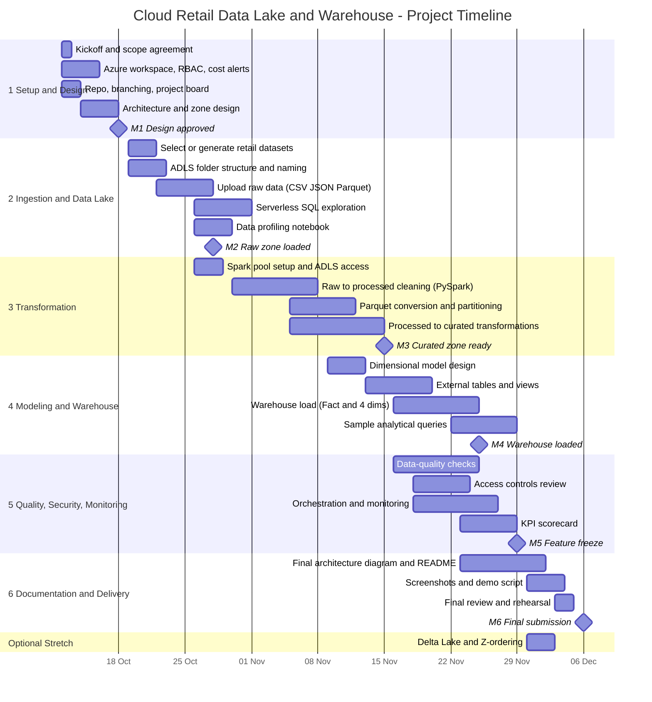

# Project Plan — Cloud Retail Data Lake & Data Warehouse

> **Status:** Draft v1 · **Owner:** M1 (Project Lead) · **Last updated:** 2026-10-10
> Dates, hours and role labels (M1–M6) are planning assumptions. Will be replaced with real names once roles have been discussed.
> !! again this is a draft. questions still needs to be answered by the lecterur. !!
---

## 1. Overview

**Objective.** Build a small-scale Azure data platform for a retail organisation using a **data lake → processing → warehouse** architecture. Raw files land in Azure Data Lake Storage Gen2 (ADLS), are cleaned and transformed with Synapse Spark (PySpark), and are served to business users through a dimensional model (Fact Sales + Dim Product, Dim Customer, Dim Store, Dim Date).

**In scope** (from the project proposal)

- Upload raw CSV / JSON / Parquet data to ADLS Gen2
- Organise the lake into `raw` / `processed` / `curated` zones
- Query lake files with Synapse serverless SQL
- Transform data with Synapse Spark / PySpark and convert suitable datasets to Parquet
- Build the dimensional model, Synapse external tables/views, and load a warehouse
- Implement basic data-quality checks, access controls, and pipeline monitoring
- Produce the documentation and deliverables listed in section 5

**Stretch goal (optional):** Delta Lake (ACID) plus partitioning / Z-ordering on selected datasets. Starts only after feature freeze (M5).

**Planning assumptions**

| Assumption | Value |
|---|---|
| Team size | 6 members |
| Effort per member | ~7 h/week |
| Duration | ~7 weeks (Mon 12 Oct → Sun 30 Nov 2026) |
| Total capacity | ~336 person-hours |
| Planned task effort | ~240 h (+16 h optional); the rest is buffer for meetings, reviews, learning curve and rework |
| Azure subscription (The Team leader, Maged still doesn't know who is going to provide that) | One shared subscription with limited credits (Further research by the team leader is required)|

---

## 2. Timeline (Gantt)

> Rendered natively by GitHub. In other viewers, paste the block into <https://mermaid.live>.

---

## 3. Phases

| # | Phase | Dates | Goal | Exit criteria |
|---|---|---|---|---|
| 1 | Setup & Design | 12 – 18 Oct | Everyone can work in Azure and Git; architecture agreed | Architecture v1 approved; all members can open the Synapse workspace and ADLS; repo and board live |
| 2 | Ingestion & Data Lake | 19 Oct – 1 Nov | Raw data in the lake and queryable | Datasets in `raw/`; serverless SQL queries return correct counts; profiling notes written |
| 3 | Transformation | 26 Oct – 15 Nov | Clean, typed, Parquet-based `processed` and `curated` zones | PySpark notebooks run end-to-end from a clean state |
| 4 | Modeling & Warehouse | 9 – 29 Nov | Star schema built and loaded; analysts can query it | Fact Sales + 4 dims loaded; external tables/views work; ≥ 8 sample queries run |
| 5 | Quality, Security, Monitoring | 16 – 29 Nov | Platform is trustworthy and observable | DQ checks automated; least-privilege access in place; pipeline runs monitored |
| 6 | Documentation & Delivery | 23 Nov – 6 Dec | Everything reproducible and presentable | README tested from a fresh clone; demo rehearsed |

---

## 4. Milestones

| ID | Date | Milestone | Acceptance criteria | Owner |
|---|---|---|---|---|
| M1 | 18 Oct | Design approved | Architecture diagram v1, zone layout, source schema / data dictionary agreed; Azure access verified for all | M1 |
| M2 | 28 Oct | Raw zone loaded | All source datasets in ADLS `raw/` (CSV, JSON, Parquet); upload steps documented | M3 |
| M3 | 15 Nov | Curated zone ready | Cleaned Parquet datasets in `processed/` and `curated/`; notebooks reproducible | M4 |
| M4 | 25 Nov | Warehouse loaded | Fact Sales and 4 dimensions loaded; external tables/views created; row counts reconcile | M5 |
| M5 | 29 Nov | Feature freeze | DQ checks, access control, monitoring and KPI scorecard in place; only docs and bug fixes afterwards | M1 |
| M6 | 6 Dec | Final submission | All deliverables complete; demo rehearsed (replace with the real deadline) | M1 |

---

## 5. Deliverables

| # | Deliverable | Accountable | Due | Status |
|---|---|---|---|---|
| 1 | Azure architecture diagram | M3 | v1: M1 · final: M6 | ⬜ |
| 2 | ADLS folder structure | M3 | M2 | ⬜ |
| 3 | PySpark notebooks | M4 | M3 | ⬜ |
| 4 | Synapse SQL scripts | M5 | M4 | ⬜ |
| 5 | Dimensional model (ERD + grain + keys) | M5 | Design: 13 Nov · final: M4 | ⬜ |
| 6 | Data-quality validation | M6 | M5 | ⬜ |
| 7 | Sample analytical queries | M6 | M5 | ⬜ |
| 8 | Pipeline screenshots | M1 (collected from M2) | M6 | ⬜ |
| 9 | Technical README | M1 | M6 | ⬜ |
| 10 | *(Optional)* Delta Lake extension | M4 | After M5 | ⬜ |

Status key: ⬜ not started · 🟨 in progress · 🟩 done · 🟥 blocked

---

## 6. Resource Allocation

### 6.1 People

| Member | Role | Owned task hours | Capacity (8 wks) | Utilisation |
|---|---|---|---|---|
| M1 | Project Lead & Documentation | 34 h | 56 h | 61% |
| M2 > M1 | Cloud Infrastructure, Security & Pipeline Ops | 35 h | 56 h | 63% |
| M3 | Ingestion & Data Lake Engineer | 42 h | 56 h | 75% |
| M4 | Transformation Engineer (PySpark) | 44 h | 56 h | 79% |
| M5 | Warehouse & Dimensional Modeling Engineer | 42 h | 56 h | 75% |
| M6 | Data Quality & Analytics Engineer | 42 h | 56 h | 75% |

> M4's work (PySpark) is on the critical path: M3 and M1 should shadow M4 during phase 3 so progress doesn't depend on one person. Optional Delta Lake (+16 h) goes to M4 only if the schedule is green after M5.

### 6.2 Involvement by phase

● lead · ○ support · – not involved

| Member | P1 Setup | P2 Lake | P3 Transform | P4 Warehouse | P5 Quality/Sec | P6 Docs |
|---|---|---|---|---|---|---|
| M1 | ● | ○ | ○ | ○ | ○ | ● |
| M2 | ● | ○ | ○ | ○ | ● | ○ |
| M3 | ● | ● | ● | ○ | – | ● |
| M4 | – | ○ | ● | ○ | ○ | – |
| M5 | ○ | ○ | ○ | ● | ○ | ○ |
| M6 | ○ | ● | ○ | ● | ● | ○ |

### 6.3 Azure resources

| Resource | Purpose | Sizing / cost control | Owner |
|---|---|---|---|
| Resource group + budget alerts | Single container for all resources | Alerts at 50 / 80 / 100% of credits | M2 |
| ADLS Gen2 storage account | Data lake (`raw`, `processed`, `curated`) | Hierarchical namespace on; LRS redundancy | M3 / M2 |
| Synapse workspace | Central workspace: SQL, Spark, pipelines, monitoring | One shared workspace | M2 |
| Serverless SQL pool | Query lake files, external tables/views | Pay per data scanned; query Parquet, avoid `SELECT *` on CSV | M5 |
| Apache Spark pool | PySpark transformations | Smallest node size, minimum nodes, **auto-pause ≈ 15 min** | M4 / M2 |
| Warehouse (dedicated SQL pool or alternative) | Serving layer for the star schema | Lowest DWU; **pause when idle**; fallback in the risk register | M5 |
| Azure Monitor / Synapse Monitor hub | Pipeline and query monitoring | Default retention | M2 |
| Key Vault *(optional)* | Secrets instead of keys in code | Only if needed | M2 |

### 6.4 Tools

GitHub (repo, pull requests, Projects board for tasks) · Synapse Studio notebooks / Jupyter · draw.io or Mermaid for diagrams · Faker or a public retail dataset for source data · a team chat channel for async updates.

---

## 7. Cadence & Communication

| Event | When | Length | Purpose |
|---|---|---|---|
| Weekly planning | Monday | 30 min | Review the board, confirm the week's tasks, check risks |
| Mid-week sync | Wednesday | 15 min | Blockers and hand-offs |
| Friday demo & retro | Friday | 30 min | Show what works; update KPI scorecard; what to change |
| Async stand-up | Mon / Wed / Fri in chat | 2 min | Done · doing · blocked |
| PR review SLA | Always | — | Reviewed within 24 h |

---

## 8. Scope & Change Control

1. Any new scope is raised as a GitHub issue labelled `scope-change`.
2. M1 plus at least two other members approve or reject within 48 h.
3. An approved change must name what it replaces or which milestone it moves.
4. The optional Delta Lake extension is **not** started until M5 is green.
